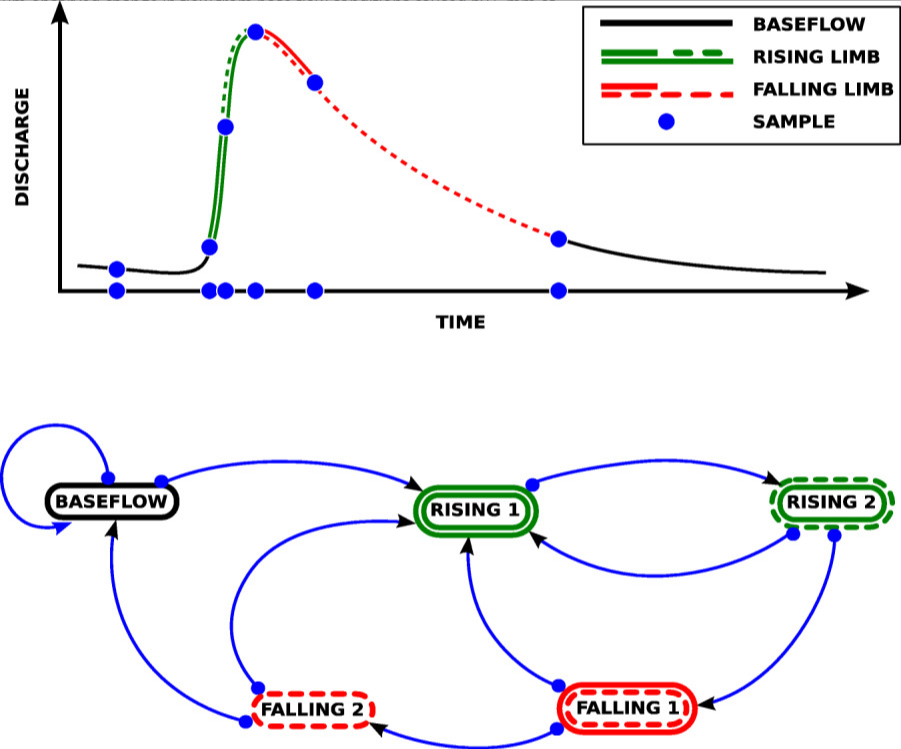

```{r}
library(readr)
library(ggplot2)
library(tidyr)
library(dplyr)
library(lubridate)
library(cowplot)


devtools::load_all() # to replace with library(adaptNP)

source('../temp/theme_gov.R') # optional theming for plots
```


```{r}
TheCutData = read_csv('../temp/HighFrequencyWQ_TheCut.csv') |> 
    mutate(`Date / time` = parse_datetime(`Date / time`, "%d/%m/%Y %H:%M"))
```


```{r}
# ggplot(TheCutData |> 
#         pivot_longer(!`Date / time`, names_to = "FIELDNAME", values_to = "VALUE"), 
#     aes(`Date / time`, VALUE)) + 
#     geom_point() + 
#     geom_smooth() + 
#     facet_wrap(vars(FIELDNAME), scales = "free")

ggplot(TheCutData, 
    aes(`Date / time`, `Flow at Binfield gauging station (m3/s)`)) + 
    geom_point() + 
    geom_smooth() 
```

### Principal component analysis
```{r}
library(stats)

set.seed(123)

keep <- complete.cases(TheCutData[ , -1])  # exclude time column
X <- scale(TheCutData[keep,-1]) #remove time, scale variables

pca <- prcomp(X, center = TRUE, scale. = TRUE)
summary(pca)


pca_var <- pca$sdev^2
pca_var / sum(pca_var)

round(pca$rotation, 2) # loadings (what each PC represents)

biplot(pca, cex = 0.8)

# PCA scores as time series (key step)
scores <- as.data.frame(pca$x)
scores$time <- TheCutData$`Date / time`[keep]

par(mfrow = c(2,1), mar = c(4,4,2,1))

plot(scores$time, scores$PC1, type = "l",
     ylab = "PC1 score", main = "PC1 (Storm-driven mode)")

plot(scores$time, scores$PC2, type = "l",
     ylab = "PC2 score", main = "PC2 (Seasonal mode)")

## plot scores only
# plot(
#   pca$x[, 1],
#   pca$x[, 2],
#   pch = 16,
#   col = rgb(0, 0, 0, 0.2),
#   xlab = "PC1",
#   ylab = "PC2"
# )     

par(mfrow = c(1,1), mar = c(4,4,2,1))

## plot loadings only
plot(
  pca$rotation[, 1],
  pca$rotation[, 2],
  type = "n",
  xlab = "PC1",
  ylab = "PC2"
)

arrows(
  0, 0,
  pca$rotation[, 1],
  pca$rotation[, 2],
  length = 0.1,
  col = "red"
)

text(
  pca$rotation[, 1],
  pca$rotation[, 2],
  labels = rownames(pca$rotation),
  pos = 3
)
```

### Baseflow separation

```{r}
library(lfstat)
TheCutDataXTS <- as.xts(TheCutData |> rename(discharge = `Flow at Binfield gauging station (m3/s)`) |> tail(8000) )
TheCutDataXTS$baseflow <- baseflow(TheCutDataXTS$discharge)
TheCutDataXTS$bf_turning <- (TheCutDataXTS$baseflow == TheCutDataXTS$discharge)

# this method gives 1000+ turning points
index(TheCutDataXTS[TheCutDataXTS$bf_turning==1])

plot(TheCutDataXTS$discharge, type = "l")
lines(TheCutDataXTS$baseflow, col = 2)
abline(a=NULL,b=NULL,h=NULL,v=index(TheCutDataXTS[TheCutDataXTS$bf_turning==1]), col="red")    

median(TheCutDataXTS$baseflow, na.rm=TRUE)

# lf <- createlfobj(
#   h     = as.numeric(x[, 1]),
#   dates = as.POSIXct(index(x)),
#   idh   = "Station_1"
# )

```

Samples rules:
Driven by flow:
1. Baseflow: every week >> sample everything
1. Low flow/algal flush + favourable DO: every day >> sample cholorophyll
1. Track hydrograph: hourly or 3 hourly TP above baseflow (median)
1. High flow for load: track hydrograph like Wong and Kerkez >> 6 points >> TP, assume perfect knowledge of storm coming

```{r}

# 1. Baseflow: every week at 1500>> sample everything

baseline <- TheCutData |> 
  mutate(hour = lubridate::hour(`Date / time`), dayofweek = lubridate::wday(`Date / time`)) |> 
  filter(dayofweek==4, hour %in% c(15))

# 2. Low flow/algal flush + favourable temperature: every day >> sample cholorophyll

criteria <-"(`Flow at Binfield gauging station (m3/s)` < 1.0) & (`Dissolved Oxygen (% saturation)` < 60)"

TheCutData <- flag_event(TheCutData,criteria)

periods  <- extract_event_periods(
   TheCutData %>% 
    rename(timestamp=`Date / time`,flag=event_flag)  |> tidyr::drop_na(flag),
  min_length=5) 

# convert period to R lubridate intervals
intervals <- periods |> 
  mutate(int = lubridate::interval(start,end) ) |> 
  pull(int)

# intervals


# very fast!
mask <- Reduce(`|`, lapply(intervals, function(int) TheCutData$`Date / time` %within% int))
rule_low_DO <- TheCutData[mask, ] |> 
  mutate(hour = lubridate::hour(`Date / time`)) |>  
  filter( hour %in% c(18))


```

1. Track hydrograph: hourly or 3 hourly TP above baseflow (median)


1. High flow for load: track hydrograph like Wong and Kerkez >> 6 points >> TP, assume perfect knowledge of storm coming


```{r above-baseflow}
# 3. Track hydrograph: hourly or 3 hourly TP above baseflow (median)
criteria <-"(`Flow at Binfield gauging station (m3/s)` > 0.122)"

TheCutData <- flag_event(TheCutData,criteria)

periods  <- extract_event_periods(
   TheCutData %>% 
    rename(timestamp=`Date / time`,flag=event_flag)  |> tidyr::drop_na(flag),
  min_length=5) 

# convert period to R lubridate intervals
intervals <- periods |> 
  mutate(int = lubridate::interval(start,end) ) |> 
  pull(int)

# intervals


# very fast!
mask <- Reduce(`|`, lapply(intervals, function(int) TheCutData$`Date / time` %within% int))
rule_above_baseflow <- TheCutData[mask, ]|> 
  mutate(hour = lubridate::hour(`Date / time`)) |>  
  filter(hour %in% c(0,3,6,9,12,15,18,21))
```


### Wong and Kerkez (2016) algorithm
<!-- A real-time probability of precipitation, obtained in our case by querying the public WeatherUndergroundforecast (Weather Underground data from http://www.wunderground.com/), is used to trigger the autosam-pler to take a water quality sample before a storm. This provides a valuable base flow measurement andsafeguards from missing measurements during instances when the hydrograph changes too rapidly or attoo small of an amplitude to be detected by flow sensors alone. The sampling algorithm (Figure 4) uses theweather forecast to trigger a sample when the chance of precipitation exceeding 5 mm within the hour sur-passes 10% (empirically determined based upon an analysis of historical forecasts and the resulting hydro-logic response). Samples are then subsequently triggered based on the estimates of the hydrograph state.While many sampling strategies are possible, in the case of this study, the states of interest included:

 1. base flow conditions right before a storm, 
 2. the onset of the hydrograph to detect a potential first flush,
 3. the inflection-point of the rising limb of the hydrograph
 4. the peak of the hydrograph 
 5. theinflection-point of the falling limb of the hydrograph, 
 6. the falling limb of the hydrograph as it returns to within 10% of the prestorm base flow. 
 
 In the case that the weather forecast is erroneous, the initiation ofa storm event is also marked when the slope in the hydrograph exceeded 7.5 m 3 over 5 min, which for ourstudy site corresponded with the minimum observed change in flow from base flow conditions caused by5 mm of precipitation in 1 h. The algorithm can also be viewed as a state machine, where samples are trig-gered during state transitions, as determined by estimates of the flow x and its derivatives. The statemachine is designed to account for multiple flow regimes (such as delayed surface flows from neighboringslopes), taking additional samples if multiple inflection points or local hydrograph peaks are detecte. -->

The Wong and Kerkez (2016, https://doi.org/10.1002/2015WR018013) algorithm uses a state machine to capture six to points in a flow hydrograph.
 1. base flow conditions right before a storm, 
 2. the onset of the hydrograph to detect a potential first flush,
 3. the inflection-point of the rising limb of the hydrograph
 4. the peak of the hydrograph 
 5. theinflection-point of the falling limb of the hydrograph, 
 6. the falling limb of the hydrograph as it returns to within 10% of the prestorm base flow. 

{.lightbox}


```{r}
RBI = sum(abs(diff(TheCutData$`Flow at Binfield gauging station (m3/s)`)), na.rm=TRUE)/sum(TheCutData$`Flow at Binfield gauging station (m3/s)`, na.rm=TRUE)

print(paste('The Richards-Baker Flashiness Index (RBI) of the station is', RBI))
```

 ```{r}
 source('../temp/state_machine.R')

flow_state =  run_state_machine(
    TheCutData$`Date / time`, 
    TheCutData$`Flow at Binfield gauging station (m3/s)`, 
    params = params)

flow_state |> head()

nrow(flow_state)

plot(
  TheCutData$`Date / time`, 
  TheCutData$`Flow at Binfield gauging station (m3/s)`, 
  type = "l",
  xlab = "Time",
  ylab = expression(Discharge~(m^3/s)),
  main = "Hydrograph at the Cut"
)

# abline(h = baseflow, col = "gray", lty = 2)
abline(a=NULL,b=NULL,h=NULL,v=flow_state$time, col="red")    

# very fast!
times = flow_state$time

# subset data by mask, note use %in% for exact time, %within% for intervals
mask <- Reduce(`|`, lapply(times, function(int) TheCutData$`Date / time` %in% int)) 
rule_state_machine <- TheCutData[mask, ]
 ```


```{r plot}

#| fig-ncol: 2
#| fig-width: 12
#| fig-asp: 5

# plot flow, and chlrophyll and P for all 4 rules
size = 0.75
sm_title = theme(plot.title = element_text(size = 20, face = "plain")) +
   theme(plot.subtitle=element_text(size=14, hjust=0.0, vjust=-0.0, 
    margin = margin(t = -10, b = -10)), face="plain", color="black")

# TOCA
pTOCA1 = ggplot() + 
  geom_point(data=TheCutData,aes(x=`Date / time`, y=`Total chlorophyll (ug/l)`), size=size) +
  geom_point(data=baseline, aes(x=`Date / time`, y=`Total chlorophyll (ug/l)`), color= 'red' ,size=2)+
   theme_gov()+ ylab('') + ggtitle('1. Full dataset and baseline', subtitle = 'Total chlorophyll (ug/l)') + ylim(0,80) + sm_title
pTOCA2 = ggplot(rule_low_DO) + geom_point(aes(`Date / time`, `Total chlorophyll (ug/l)`), size=size) +
   theme_gov()+ ylab('') + ggtitle('2. low flow, low DO', subtitle = 'Total chlorophyll (ug/l)') + ylim(0,80) + xlim(range(TheCutData$`Date / time`))+ sm_title
pTOCA3 = ggplot(rule_above_baseflow) + geom_point(aes(`Date / time`, `Total chlorophyll (ug/l)`), size=size) +   theme_gov()+ ylab('') + ggtitle('3. Flow above baseflow', subtitle = 'Total chlorophyll (ug/l)') + ylim(0,80) + xlim(range(TheCutData$`Date / time`)) + sm_title
pTOCA4 = ggplot(rule_state_machine) + geom_point(aes(`Date / time`, `Total chlorophyll (ug/l)`), size=size) +
   theme_gov()+ ylab('') + ggtitle('4. modfied Wong and Kerkez', subtitle = 'Total chlorophyll (ug/l)') + ylim(0,80) + xlim(range(TheCutData$`Date / time`)) + sm_title

# total P
pTP1 = ggplot() + 
  geom_point(data=TheCutData,aes(x=`Date / time`, y=`Total Phosphorus (mg/l)`), size=size) +
  geom_point(data=baseline, aes(x=`Date / time`, y=`Total Phosphorus (mg/l)`), color= 'red' ,size=2)+   theme_gov()+ ylab('') + sm_title + 
   ggtitle('1. Full dataset and baseline', subtitle = 'Total Phosphorus (mg/l)') + 
   scale_y_continuous(trans='log10', limits = c(0.2,3)) 
   
pTP2 = ggplot(rule_low_DO) + 
   geom_point(aes(`Date / time`, `Total Phosphorus (mg/l)`), size=size) +
   theme_gov()+ ylab('') + sm_title + 
   ggtitle('2. low flow, low DO', subtitle = 'Total Phosphorus (mg/l)') + 
   scale_y_continuous(trans='log10', limits = c(0.2,3)) 

pTP3 = ggplot(rule_above_baseflow) + 
   geom_point(aes(`Date / time`, `Total Phosphorus (mg/l)`), size=size) +
   theme_gov()+ ylab('') + sm_title + 
   ggtitle('3. Flow above baseflow', subtitle = 'Total Phosphorus (mg/l)') + 
   scale_y_continuous(trans='log10', limits = c(0.2,3)) 

pTP4 = ggplot(rule_state_machine) + 
   geom_point(aes(`Date / time`, `Total Phosphorus (mg/l)`), size=size) +
   theme_gov()+ ylab('') + sm_title + 
   ggtitle('4. modfied Wong and Kerkez', subtitle = 'Total Phosphorus (mg/l)') + 
   scale_y_continuous(trans='log10', limits = c(0.2,3)) 

# plot_grid(
#   pTOCA1,pTOCA2,pTOCA3,pTOCA4,
#   labels = "auto", ncol = 1, label_x = 0.05
# )

# # size 1000 x 750 or 1000x 1000
# plot_grid(
#   pTOCA1,pTOCA2,pTOCA3,pTOCA4, pTP1,pTP2,pTP3,pTP4,
#   labels = letters[c(1,3,5,7,2,4,6,8)],label_x = 0.05,ncol=2, byrow = FALSE, label_size = 18
# )
print(pTOCA1)
print(pTOCA2)
print(pTOCA3)
print(pTOCA4)
print(pTP1)
print(pTP2)
print(pTP3)
print(pTP4)

# plot_grid(p1,p2,ncol=2)
```

```{r metrics}

a = diff(range(TheCutData$`Total Phosphorus (mg/l)`, na.rm = TRUE))

diff(range(baseline$`Total Phosphorus (mg/l)`, na.rm = TRUE)) /a
diff(range(rule_low_DO$`Total Phosphorus (mg/l)`, na.rm = TRUE)) /a
diff(range(rule_above_baseflow$`Total Phosphorus (mg/l)`, na.rm = TRUE)) /a
diff(range(rule_state_machine$`Total Phosphorus (mg/l)`, na.rm = TRUE)) /a

b = median(TheCutData$`Total Phosphorus (mg/l)`, na.rm = TRUE)
(median(baseline$`Total Phosphorus (mg/l)`, na.rm = TRUE) -b) /b 
(median(rule_low_DO$`Total Phosphorus (mg/l)`, na.rm = TRUE) -b) /b 
(median(rule_above_baseflow$`Total Phosphorus (mg/l)`, na.rm = TRUE) -b) /b 
(median(rule_state_machine$`Total Phosphorus (mg/l)`, na.rm = TRUE) -b) /b 


```

```{r}
a = diff(range(TheCutData$`Total chlorophyll (ug/l)`, na.rm = TRUE))

diff(range(baseline$`Total chlorophyll (ug/l)`, na.rm = TRUE)) /a
diff(range(rule_low_DO$`Total chlorophyll (ug/l)`, na.rm = TRUE)) /a
diff(range(rule_above_baseflow$`Total chlorophyll (ug/l)`, na.rm = TRUE)) /a
diff(range(rule_state_machine$`Total chlorophyll (ug/l)`, na.rm = TRUE)) /a

b = median(TheCutData$`Total chlorophyll (ug/l)`, na.rm = TRUE)
(median(baseline$`Total chlorophyll (ug/l)`, na.rm = TRUE) -b) /b 
(median(rule_low_DO$`Total chlorophyll (ug/l)`, na.rm = TRUE) -b) /b 
(median(rule_above_baseflow$`Total chlorophyll (ug/l)`, na.rm = TRUE) -b) /b 
(median(rule_state_machine$`Total chlorophyll (ug/l)`, na.rm = TRUE) -b) /b 

```
```{r}

# ## plot flow and PCA loadings

# ## plot loadings only
# p3 <- ~plot(
#   pca$rotation[, 1],
#   pca$rotation[, 2],
#   type = "n",
#   xlab = "PC1",
#   ylab = "PC2"
# )

# arrows(
#   0, 0,
#   pca$rotation[, 1],
#   pca$rotation[, 2],
#   length = 0.1,
#   col = "red"
# )

# text(
#   pca$rotation[, 1],
#   pca$rotation[, 2],
#   labels = rownames(pca$rotation),
#   pos = 3
# )
```